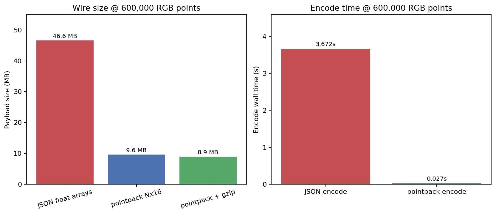

# Fast Binary Wire Encoding for Large RGB Point Clouds

Monocular depth and Gaussian pipelines routinely emit **0.5–1.2M** colored
points per frame. Serving them as JSON `[[x,y,z,r,g,b], …]` makes encode CPU
and payload size the bottleneck: every float becomes text, and every request
re-pays that cost.

**pointpack** replaces that with a fixed **16-byte** record per point
(`float32` xyz + `uint8` rgb + pad), optional gzip when it actually shrinks
the body, and uniform LOD to a point budget. Encode is memcpy-class; repeat
serves can cache the packed (and gzip) bytes.

| Path | Encode | Size |
| --- | --- | --- |
| JSON float arrays | O(N) text serialization | ~tens of MB at 600k points |
| **pointpack `N×16`** | O(N) packed binary | ~4.9× smaller at 600k |
| + conditional gzip | level 4, only if ≥5% smaller | further cut when compressible |
| + uniform LOD to `K` | `linspace` index pick | space O(N) → O(K) |



## Install

```bash
pip install -e .
```

## Usage

```python
import time
import numpy as np
import pointpack

xyz = np.random.randn(600_000, 3).astype(np.float32)
rgb = (np.random.rand(600_000, 3) * 255).astype(np.uint8)

xyz_k, rgb_k = pointpack.uniform_lod(xyz, rgb, max_points=400_000)
blob = pointpack.pack(
    meta={"frame": "opencv", "source_count": int(len(xyz))},
    xyz=xyz_k,
    rgb=rgb_k,
    unix_ms=int(time.time() * 1000),
)
body, encoding = pointpack.compress_body(blob)  # encoding is "gzip" or None

meta, xyz_out, rgb_out, unix_ms = pointpack.unpack(blob)
```

HTTP: serve `body` as `application/octet-stream`, `ETag` from
`pointpack.etag_for_unix_ms(unix_ms)`, and `Content-Encoding: gzip` when
`encoding == "gzip"`. Cache packed/gzip bytes for static clouds.

## Bench

```bash
python benchmarks/bench_pack.py --n 600000
# regenerates docs/bench_pack.png
```

## Wire layout

```
PTPACK01 | meta_len:u32 | point_count:u32 | unix_ms:u64 | meta JSON | Nx16 points
```

Each point: `x,y,z` little-endian float32, `r,g,b` uint8, 1 pad byte.

## License

MIT. Works for any colored point stream (SHARP display LOD, LiDAR RGB, mesh
samples) — not tied to a single upstream model.
